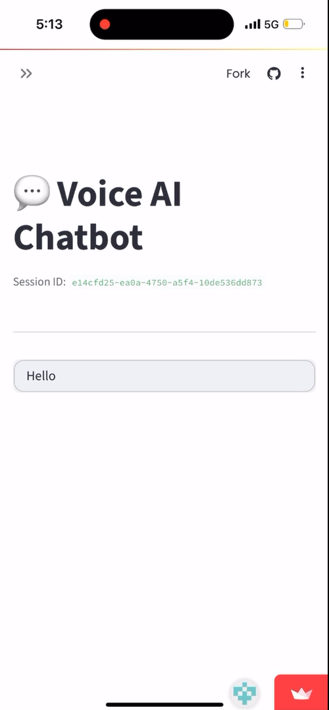

# VakyaAI — Multilingual AI Language Learning Platform

## 🌍 Overview
**VakyaAI** is an intelligent language learning platform that combines conversational AI with multilingual text and voice interactions to create an engaging, personalized learning experience.

Powered by **Natural Language Processing (NLP)**, **LangGraph-based conversational memory**, and **Groq-hosted LLaMA models**, VakyaAI enables users to practice languages through real-time conversations while receiving grammar corrections, vocabulary suggestions, and context-aware feedback.

The platform supports both **text-based and voice-based interactions**, helping learners improve their **speaking, listening, reading, and writing** skills through interactive AI-driven practice.

---

## Features

🌐 Multilingual Conversational AI — Enables interactive conversations across multiple languages with contextual understanding.
🎙️ Voice & Text-Based Communication — Allows users to interact through text or speech and receive text and audio responses.
🧠 Context-Aware Conversational Memory — Uses LangGraph to maintain conversation history and generate coherent, contextually relevant responses.
✍️ Intelligent Grammar Correction — Helps learners identify grammatical errors and improve sentence construction.
📚 Vocabulary Enhancement — Provides vocabulary suggestions and contextual language assistance during conversations.
⚡ Real-Time AI Responses — Leverages Groq-hosted LLaMA models for fast, low-latency conversational inference.
🗣️ Interactive Speaking Practice — Encourages users to develop speaking fluency through AI-powered conversations.
🔊 Listening & Audio Practice — Supports listening practice through speech-based interactions and audio responses.
🖥️ User-Friendly Web Interface — Built with Streamlit to provide a simple and accessible learning environment.
🎯 Self-Paced Learning Experience — Allows learners to practice at their own pace through flexible, interactive sessions.
💬 Personalized Learning Assistance — Provides context-aware feedback and language guidance based on ongoing conversations.
🌍 Accessible Language Practice — Makes conversational language practice available without requiring a human conversation partner.

---

## Use Cases

* **Language Learning** — Helps students, travelers, and professionals practice multilingual communication.
* **Pronunciation Practice** — Supports speaking practice through speech-to-text and audio feedback.
* **Conversational Learning** — Enables learners to improve fluency through interactive AI-powered dialogues.
* **AI-Assisted Tutoring** — Facilitates personalized language learning in multilingual educational environments.

---

| Component            | Technology/Library                     | Purpose                                       |
| -------------------- | -------------------------------------- | --------------------------------------------- |
| Frontend/UI          | **Streamlit**                          | Simple web app interface                      |
| AI Model             | **Groq (Llama 3 70B via Groq API)**    | Generates AI chat responses                   |
| Text-to-Speech (TTS) | **gTTS (Google Text-to-Speech)**       | Converts text responses to speech             |
| Speech-to-Text (STT) | **SpeechRecognition + Google API**     | Converts voice input to text (local only)     |
| Environment Vars     | **python-dotenv**                      | Loads API keys from `.env` securely           |
| Audio Encoding       | **base64**                             | Embeds audio players in the web page          |
| Utilities            | **uuid, datetime, re**                 | Manage session IDs, time stamps, text cleanup |
| Deployment           | **Streamlit Community Cloud / GitHub** | Host app online                               |


---

## 🎥 Demo Video

### 📱 Mobile App Demo
This is how it works when you use VakyaAI as a mobile app.

[](Video-demo/Mobile-app.mp4)

Click the image above to watch the demo video showcasing the multilingual language learning mobile app in action.

---

### 💻 Local Deployment Demo
This is how it works when this repository is cloned into your local system and run.

[](Video-demo/Voice%20AI%20Chatbot.mp4)

Click the image above to watch the demo video showcasing the AI-powered voice chatbot running locally.

## 🚀 Installation & Setup

1. Clone the repository:
```bash
git clone https://github.com/your-username/VakyaAI.git
cd VakyaAI

pip install -r requirements.txt

streamlit run app/main.py
```

How to Use VakyaAI
  Open the web interface.
  Select your preferred language.
  Choose Text Chat or Voice Chat.
  Start interacting with the AI — get grammar corrections, vocabulary suggestions, and pronunciation feedback.
